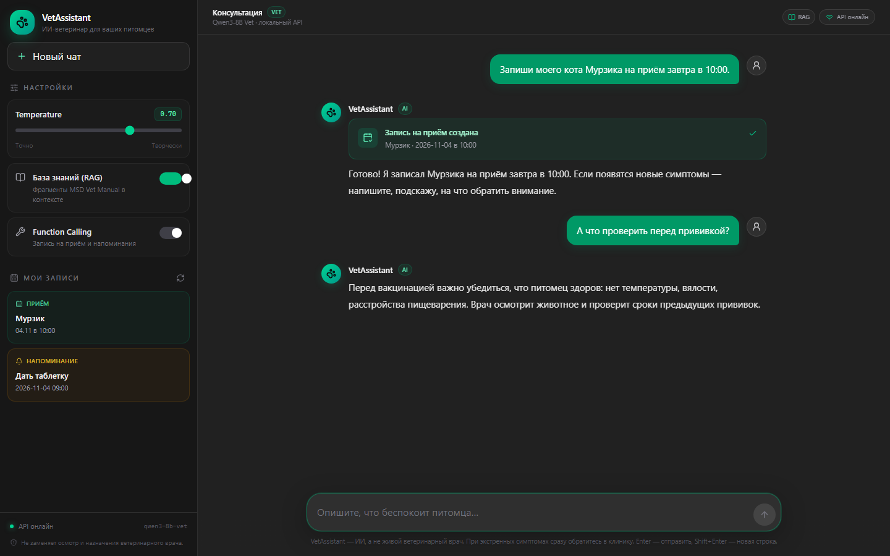

# VetAssistant: Русскоязычный ветеринарный ИИ-ассистент

[](https://github.com/iilmchat/ai_VetAssistant/actions/workflows/ci.yml)
[](https://github.com/iilmchat/ai_VetAssistant/releases/latest)
[](SECURITY.md)

> Легковесный ассистент на базе Qwen3-8B (GGUF), работающий на CPU без GPU. Специализируется на многотурном диалоге с владельцами животных, соблюдает медицинские рамки безопасности, вызывает инструменты, сохраняет записи в базе данных и опирается на MSD Vet Manual.

**Статус:** ✅ **Production Ready — v1.6.1** (2026-11-06)
**Релиз:** hotfix: потокобезопасная генерация (H-1), очистка `<think>` (H-4),
актуальная дата в промпте (H-3), понятная ошибка повторного `/link` (H-2),
уведомления только о записи к врачу (H-5)
**Фаза 3:** ✅ наблюдаемость (Prometheus + Grafana) и RAG на ChromaDB

- **Telegram:** отдельный процесс/контейнер `bot`; запись питомца на приём и напоминания прямо из чата; привязка к веб-аккаунту по одноразовому коду (`/link`), уведомления в чат и доступ в production — только по allowlist Telegram ID
- **Web:** React 19 + Vite + TypeScript + Tailwind CSS — SSE-чат в стиле ChatGPT, настройки и «Мои записи»
- **Экспорт:** история диалога скачивается в Markdown одной кнопкой
- **Auth:** JWT (HS256), bcrypt-пароли и изоляция записей по `user_id` в вебе, Streamlit и Telegram
- **Production:** Ubuntu VPS, Docker Compose, два домена — лендинг
  `ai-pets.ru` и приложение `app.ai-pets.ru`; HTTPS через Caddy/Let's Encrypt
- **Порты:** `80`/`443` — production, `3000` — Docker dev/Nginx, `5173` — Vite dev server
- **Метрики:** Prometheus `GET /metrics` + Grafana — HTTP-запросы, латентность LLM, токены, TTFT и RAG
- **Админ-панель:** заявки на доступ, approve с одноразовым паролем и reject с причиной; вкладка «Аналитика» — запросы, токены, RAG hit rate и топ пользователей
- **CI/CD:** GitHub Actions на self-hosted runner VPS — линтеры, тесты, Docker-сборка, деплой и GitHub Releases по тегам
- **Дистрибуция:** Docker Compose (`docker compose up --build`)
- **Целевой инференс:** llama.cpp / `llama-cpp-python` (GGUF Q4_K_M, CPU, 8–16 ГБ RAM)
- **API:** FastAPI, OpenAI-совместимый `POST /v1/chat/completions`
- **Обучение:** Unsloth + QLoRA на арендованных GPU (Vast.ai / RunPod)
- **Генерация данных:** Зарубежные LLM через API (слой абстракции)

**Документация:** [SECURITY.md](SECURITY.md) · [DEPLOYMENT.md](DEPLOYMENT.md) · [CHANGELOG.md](docs/CHANGELOG.md)

## 🌐 Архитектура доменов

Лендинг и приложение разнесены по доменам — это финал Фазы 2:

| URL | Что отдаёт | Контейнер |
|---|---|---|
| `https://ai-pets.ru/` | статический лендинг (индексируется) | `vetassistant-landing` (nginx) |
| `https://ai-pets.ru/privacy/` | политика конфиденциальности | `vetassistant-landing` |
| `https://ai-pets.ru/terms/` | условия использования | `vetassistant-landing` |
| `https://app.ai-pets.ru/` | React SPA, `X-Robots-Tag: noindex` | `vetassistant-frontend` (nginx) |
| `https://app.ai-pets.ru/api/*` | FastAPI | `vetassistant-api:8000` |
| `https://www.ai-pets.ru/` | 301 на `https://ai-pets.ru/` | Caddy |

- TLS терминирует Caddy на edge-хосте; лендинг и приложение портов на хост не
  публикуют и доступны только по сети `edge`.
- `app.ai-pets.ru` получает сертификат автоматически (ACME HTTP-01/TLS-ALPN);
  HSTS с `includeSubDomains` требует сначала проверить TLS поддомена.
- Служебные файлы лендинга (`README.md`, `DEPLOY.md`, `nginx.conf`,
  `compose.edge.fragment.yml`, `Caddyfile.edge.snippet`) вынесены из web-root в
  [`docs/landing/`](docs/landing/README.md); Caddy-матчер `@landing_private`
  удалён, служебные пути по-прежнему отдают 404.
- План и история работ: [PHASE2_LANDING_APP.md](docs/development/PHASE2_LANDING_APP.md).

## 📊 Фаза 3 — наблюдаемость и RAG (завершена)

**Статус:** ✅ **Фаза 3 завершена.** Prometheus собирает метрики, Grafana
настроена, RAG работает в production: тестовый запрос про парацетамол дал
hit из ChromaDB.

- **Prometheus:** API отдаёт `/metrics`
  (`prometheus-fastapi-instrumentator`): `http_requests_total`,
  `http_request_duration_seconds` и кастомные `vet_llm_*` / `vet_rag_*` —
  вызовы модели, токены промпта и генерации, время генерации, TTFT, скорость
  токенов/с, RAG-поиски и `vet_rag_index_ready`. Prometheus скрапит внутренний
  `vetassistant-api:8000` по сети `edge`; публичный `/api/metrics` закрывается
  в Caddy.
- **Grafana:** развёрнута на VPS рядом с Prometheus. Дашборды: RPS и p95
  HTTP-латентности, токены/с, p95 TTFT, доля RAG-hit и алерт
  `vet_rag_index_ready == 0` после деплоя.
- **RAG:** ChromaDB-коллекция `msd_vet_manual` — **204 чанка** из семи статей
  MSD Vet Manual (включая шоколад, блохи, клещи и вакцинацию) и трёх
  демо-файлов; API подтверждает `vet_rag_index_ready 1.0`, тестовый запрос про
  парацетамол дал RAG-hit.
  `scripts/ingest_knowledge.py` обновляет индекс через `upsert` и не удаляет
  существующие чанки; `--rebuild` — только осознанно. В контейнере скрипт
  работает без флагов: пути по умолчанию — `/app/data/knowledge` и
  `/app/data/chroma_db`.
- **Документация:** [DEPLOYMENT.md](DEPLOYMENT.md) — проверка `/metrics`,
  список метрик и scrape-конфиг Prometheus.

## 🚀 v1.1.0 — Security and Memory Optimizations

**Релиз:** смена пароля, экономия RAM и базовая защита сервера.

- **Смена пароля (T-103):** `POST /v1/auth/change-password`, модальная форма
  в React-сайдбаре, уведомление и разлогин после успеха.
- **Память (T-101):** `VET_API_N_CTX=4096` по умолчанию, конфигурация в
  `/health` и скрипт `scripts/check_ram.py` для мониторинга.
- **Безопасность (T-104):** `scripts/setup_ufw.sh` открывает только
  `22`/`80`/`443` и включает UFW.
- **Git-деплой (T-106):** документация SSH-алиаса
  `github.com-vetassistant` для сервера с несколькими ключами.
- **Качество:** 572 Python-теста и 31 frontend-тест, `ruff`, `mypy`,
  `oxlint`, Docker-сборки и CI.

## 🚀 v1.0.0 — Production Ready

[](docs/assets/react-ui.png)

**Финальный аккорд:** проект прошёл путь от идеи и синтетических данных до
полноценного multi-tenant SaaS. В 1.0.0 вошли JWT-авторизация, изоляция
данных пользователей, production-деплой на одном домене, HTTPS и
Telegram-бот.

- **Multi-tenant SaaS**: регистрация/вход, bcrypt-пароли, JWT HS256 и
  изоляция приёмов, напоминаний и истории по `user_id`.
- **Production Ready**: `docker-compose.prod.yml`, единый домен через Nginx,
  Let's Encrypt/Certbot, HSTS и автоматический HTTP→HTTPS-редирект.
- **Telegram**: синтетические аккаунты на HMAC-пароле, кэш JWT и повторная
  авторизация при `401`.
- **AI-ядро**: Qwen3-8B GGUF на CPU, RAG по MSD Vet Manual, Agentic Loop с
  `book_appointment` и `set_reminder`.
- **Качество**: **569** Python-тестов и **29** frontend-тестов, `ruff`,
  `mypy`, `oxlint`, Docker-сборки и CI на каждый коммит.
- **Эксплуатация**: `scripts/deploy.sh`, `scripts/renew_ssl.sh`, бэкапы,
  диагностика и security-чеклист.

### Документация релиза

| Документ | О чём |
|---|---|
| [SECURITY.md](SECURITY.md) | Политика безопасности, отчёты об уязвимостях и production-чеклист |
| [DEPLOYMENT.md](DEPLOYMENT.md) | Пошаговый деплой на Ubuntu VPS, DNS, HTTPS и Certbot |
| [CHANGELOG.md](docs/CHANGELOG.md) | Полная история проекта и детали v1.0.0 |
| [README.md](README.md) | Обзор, локальный запуск, API, RAG и Telegram |

> От первого seed-файла до `https://vetassistant.ru` — VetAssistant готов
> к реальным пользователям, реальным питомцам и реальной ответственности.
> Спасибо всем, кто прошёл этот путь. 🐾

## 🏁 Предыдущие релизы

### v0.5.0 — 2026-11-03 — React web interface

- **React 19 Frontend**: новый SPA в `frontend/` на Vite, TypeScript и
  Tailwind CSS 4 — чат в стиле ChatGPT с боковой панелью и адаптивной
  вёрсткой для телефона.
- **SSE-стриминг**: ответы `/v1/chat/completions` появляются постепенно;
  генерацию можно остановить, Markdown и таблицы рендерятся через
  `react-markdown`.
- **UI для Function Calling**: переключатели RAG и инструментов,
  `temperature`, зелёные/янтарные бейджи записей и напоминаний, блок
  **«Мои записи»**.
- **Docker/Nginx**: multi-stage `frontend/Dockerfile`, сервис `frontend` в
  Compose на порту **3000**; Nginx раздаёт SPA и проксирует `/api/*` в
  `api:8000` без буферизации SSE.
- **CORS и тесты**: FastAPI разрешает `localhost:5173` для Vite; **22**
  фронтенд-теста и **518** тестов проекта.
- Подробности: [CHANGELOG.md](docs/CHANGELOG.md).

### v0.4.0 — 2026-11-03 — Telegram-бот

- **Telegram-бот** на aiogram 3.x: отдельный процесс `python -m bot` и
  контейнер `bot`; команды `/start`, `/reset` и `/help`.
- **История диалогов** для каждого пользователя: бот передаёт предыдущие
  сообщения в API и помнит контекст беседы.
- **Function Calling**: запись питомца на приём и создание напоминаний с
  понятными подтверждениями прямо в чате.
- **Интеграция с API**: бот использует тот же локальный
  `POST /v1/chat/completions` с RAG и инструментами; ошибки API
  показываются пользователю человекочитаемо.
- **Docker Compose**: сервис `bot` зависит от здорового `api` и читает
  `TELEGRAM_BOT_TOKEN`; без токена API и Streamlit UI продолжают работать.
- **Тесты**: **516** тестов, включая клиент API и логику бота с фейковыми
  Telegram и FastAPI.
- Подробности: [CHANGELOG.md](docs/CHANGELOG.md).

### v0.3.0 — 2026-11-03 — Autonomous Agent

- **Agentic Loop**: модель вызывает `book_appointment` и `set_reminder`, API
  выполняет инструменты, передаёт результат обратно модели и возвращает
  финальный ответ.
- **База данных**: PostgreSQL 16 в Docker Compose и async SQLAlchemy 2.0;
  записи и напоминания сохраняются в volume и не теряются при перезапуске.
  Локально используется async SQLite.
- **Реальный RAG**: загрузка статей MSD Vet Manual, поддержка TXT/PDF,
  ChromaDB и мультиязычная модель эмбеддингов.
- **Streamlit UI**: потоковый чат, RAG, Function Calling, бейджи инструментов
  и раздел **«Мои записи»**.
- **CI/CD**: GitHub Actions проверяет `ruff`, `mypy`, `pytest` (**487 тестов**),
  собирает Docker-образ и публикует GitHub Release по тегу `v*`.
- Подробности: [CHANGELOG.md](docs/CHANGELOG.md),
  [EVAL_ROUTER.md](docs/development/reports/EVAL_ROUTER.md).

### v0.2.0 — 2026-11-03

- **Streamlit UI** с потоковым выводом, историей чата и настройкой RAG.
- **RAG на ChromaDB**: локальная база знаний MSD Vet Manual и
  мультиязычная модель эмбеддингов.
- **Router & Triage**: мгновенная детекция экстренных симптомов и
  prompt injection до вызова LLM; F1 = **1.0000** на бенчмарке.
- **Docker-дистрибутив**: FastAPI и Streamlit UI одной командой
  `docker compose up --build`.
- **CI/CD**: GitHub Actions проверяет `ruff`, `mypy`, `pytest` и собирает
  Docker-образ на каждый push/PR в `main`.
- Подробности: [CHANGELOG.md](docs/CHANGELOG.md),
  [EVAL_ROUTER.md](docs/development/reports/EVAL_ROUTER.md).

### v0.1.0 — 2026-11-02

- Дообучена **Qwen3-8B Vet** (QLoRA SFT, GGUF Q4_K_M); `train_loss=0.5922`,
  `eval_loss=0.483`.
- PetQA-Bench: **2000/2000** ответов, LLM-Judge — **4.5185 / 5**,
  **97.7%** оценок ≥ 4.
- Safety через локальный API: **passed=2, failed=0** (парацетамол, феназепам).
- Модель интегрирована в **FastAPI** с OpenAI-совместимым API и SSE-стримингом,
  работает локально через `llama-cpp-python`.
- Подробности: [MODEL_CARD.md](MODEL_CARD.md), [EVAL_V1.md](docs/development/reports/EVAL_V1.md),
  [CHANGELOG.md](docs/CHANGELOG.md).

## 📚 Документация проекта

Вся документация находится в корне или папке `docs/`:

| Документ | Описание |
|---|---|
| [**Design.md**](docs/development/Design_v1.md) | **Источник истины.** Архитектура пайплайна, выбор моделей, инфраструктура, риски. |
| [**MODEL_CARD.md**](MODEL_CARD.md) | Карточка модели: назначение, данные, метрики, ограничения. |
| [**EVAL_V1.md**](docs/development/reports/EVAL_V1.md) | Отчёт об обучении, генерации, LLM-Judge и Safety-проверке. |
| [**EVAL_ROUTER.md**](docs/development/reports/EVAL_ROUTER.md) | Precision/Recall/F1 роутера на бенчмарке экстренных случаев и инъекций. |
| [**CHANGELOG.md**](docs/CHANGELOG.md) | История релизов и ключевые вехи проекта. |
| [**synthetic_prompts.md**](docs/synthetic_prompts.md) | Библиотека промптов для двухшаговой генерации (Шаг A + Шаг B) и Safety-кейсов. |
| [**eval_harness.md**](docs/eval_harness.md) | Структура бенчмарка, JSONL-схемы, метрики (MCQ, Safety, Multi-turn) и код `evaluate.py`. |
| [**TRAINING.md**](docs/development/TRAINING.md) | Развертывание на GPU-сервере Selectel и запуск обучения. |
| [**BRANCH_PROTECTION.md**](docs/development/BRANCH_PROTECTION.md) | Настройка защиты `main`: PR, обязательные CI-проверки. |
| [**RULES.md**](docs/development/RULES.md) | **Обязательно к прочтению.** Правила коммитов, код-стайла и отчетности для агента. |
| [**TODO.md**](TODO.md) | Пошаговый план работ с зависимостями и Definition of Done. |

## 🚀 Быстрый старт для разработки

1. Скопируйте `.env.example` в `.env` и заполните API-ключи учителя (OpenAI-совместимые).
2. Установите зависимости: `pip install -e ".[dev]"`
3. Запустите генерацию пилотного батча:
   ```bash
   python scripts/generate_data.py --stage pilot --limit 50
   ```
4. Проверьте качество датасета:
   ```bash
   python scripts/validate_dataset.py data/pilot.jsonl
   ```

## 🪟 Запуск FastAPI-сервера на Windows

### 1. Установка `llama-cpp-python`

На Windows `pip install llama-cpp-python` часто пытается собрать пакет из
исходников и требует Visual Studio Build Tools (C++). Проще поставить готовый
CPU-wheel:

```powershell
pip install llama-cpp-python --extra-index-url https://abetlen.github.io/llama-cpp-python/whl/cpu
```

Для CUDA используйте соответствующий индекс, например
`https://abetlen.github.io/llama-cpp-python/whl/cu121` (или `cu124`), и
подходящую версию Python. После установки wheel выполните:

```powershell
pip install -e .
```

`llama-cpp-python` уже будет установлен, и pip не станет собирать его заново.

### 2. Модель

Основная модель лежит в `data/gguf/qwen3-8b-vet-Q4_K_M.gguf`. Если файла нет,
получите его через DVC:

```powershell
python scripts/sync_data.py pull
```

### 3. Запуск API

```powershell
python -m uvicorn app.main:app --host 127.0.0.1 --port 8000
```

Эквивалентный вариант, если `uvicorn` доступен как консольная команда:

```powershell
uvicorn app.main:app --host 127.0.0.1 --port 8000
```

Проверка живости:

```powershell
Invoke-RestMethod -Uri http://127.0.0.1:8000/health
```

Пример запроса:

```powershell
$body = @{
  messages = @(@{ role = "user"; content = "Кот не ест сутки, что делать?" })
} | ConvertTo-Json -Depth 5
Invoke-RestMethod -Uri http://127.0.0.1:8000/v1/chat/completions `
  -Method Post -ContentType "application/json" -Body $body
```

Для стриминга добавьте в тело `stream = $true` — API вернёт SSE-поток
(`text/event-stream`).

Настройки модели можно переопределить через `.env`:
`VET_API_MODEL_PATH`, `VET_API_MODEL_ID`, `VET_API_N_CTX`,
`VET_API_N_THREADS`, `VET_API_N_GPU_LAYERS`.

### 4. Safety-проверка через локальный API

```powershell
python scripts/test_safety.py `
  --base-url http://127.0.0.1:8000/v1 `
  --model-id qwen3-8b-vet
```

Скрипт берёт Safety-кейсы из `data/eval_dataset.jsonl`, отправляет их в
`POST /v1/chat/completions` и проверяет отсутствие назначения запрещённых
препаратов, наличие отказа и направления к ветеринару.

Результат релиза v0.1.0: **passed=2, failed=0** — оба кейса (парацетамол и
феназепам) корректно отказали и направили к ветеринару.

### 5. Оценка через локальный API

Флаг `--local-api` подставляет `http://127.0.0.1:8000/v1` и модель
`qwen3-8b-vet` (значения можно переопределить через `--base-url`/`--model-id`):

```powershell
python evaluation/evaluate.py --local-api `
  --dataset data/eval_dataset.jsonl `
  --output data/local_answers.jsonl
```

## 🖥️ Веб-интерфейс Streamlit

Убедитесь, что FastAPI-сервер уже запущен (см. раздел выше), затем установите
зависимости и запустите UI:

```powershell
pip install -e .
streamlit run app/ui.py
```

Если команда `streamlit` не найдена в PATH:

```powershell
python -m streamlit run app/ui.py
```

Streamlit откроет браузер на `http://localhost:8501`. В интерфейсе доступны:

- чат с моделью через `POST /v1/chat/completions`;
- потоковый вывод ответа (эффект печатной машинки);
- история сообщений в `st.session_state`;
- слайдер `temperature` (0.0–1.0, по умолчанию 0.7);
- переключатель Function Calling и бейджи вызова инструментов;
- раскрывающийся список **«Мои записи»** с приёмами и напоминаниями;
- кнопка «Очистить историю чата».

Если API выключен, UI покажет сообщение
**«Сервер ветеринара спит, включите uvicorn»**.

## ⚛️ React-веб-интерфейс

Современный чат в стиле ChatGPT: React 19, Vite, TypeScript и Tailwind CSS 4.
Ответы приходят через SSE и появляются постепенно, Markdown и таблицы
рендерятся через `react-markdown`, а вызовы `book_appointment` и
`set_reminder` показываются зелёными и янтарными бейджами.

В интерфейсе есть:

- экран входа: без JWT показывается форма, после входа токен
  хранится в `localStorage`; новый аккаунт можно запросить кнопкой
  **«Запросить доступ»**;
- кнопка **«Выйти»** и email текущего пользователя в сайдбаре;
- боковая панель с настройками `temperature`, RAG и Function Calling;
- блок **«Мои записи»** с приёмами (`/v1/appointments`) и напоминаниями;
- история диалога в `localStorage` отдельно для каждого пользователя,
  кнопка «Новый чат» и остановка генерации;
- индикатор доступности API и адаптивная вёрстка для телефона.

### Локальный запуск (порт 5173)

Нужен Node.js 20.19+ (или 22.12+) и запущенный FastAPI на
`http://127.0.0.1:8000`.

```powershell
cd frontend
npm install
npm run dev
```

Откройте `http://localhost:5173`. По умолчанию фронтенд обращается к
`http://127.0.0.1:8000`; адрес можно изменить в `frontend/.env`:

```dotenv
VITE_API_BASE_URL=http://127.0.0.1:8000
VITE_MODEL_ID=qwen3-8b-vet
```

FastAPI разрешает CORS для `http://localhost:5173` и
`http://127.0.0.1:5173`. Проверка сборки и тестов:

```powershell
cd frontend
npm run build
npm test
npm run lint
```

### Запуск в Docker (порт 3000)

```powershell
docker compose up --build frontend
```

Фронтенд будет доступен на `http://localhost:3000`. Nginx раздаёт статику и
проксирует `/api/*` в сервис `api`, поэтому браузер не обращается к
`api:8000` напрямую, а SSE не буферизуется.

## 🤖 Telegram-бот

Бот работает отдельным процессом, хранит историю диалога для каждого
пользователя и обращается к тому же FastAPI. Поддерживаются команды
`/start`, `/reset`, `/help`, `/link КОД`, `/unlink`, `/status`, а также
Function Calling: запись питомца на приём и создание напоминания.

### 1. Получите токен у @BotFather

1. Откройте в Telegram бота **[@BotFather](https://t.me/BotFather)**.
2. Отправьте команду `/newbot`.
3. Задайте имя бота (например, `VetAssistant`) и username, который
   заканчивается на `bot` (например, `vet_assistant_bot`).
4. Скопируйте токен вида `123456789:AA...`.
5. Добавьте его в `.env` в корне проекта:

   ```dotenv
   TELEGRAM_BOT_TOKEN=123456789:AA...
   ```

   Токен — секрет. Не коммитьте `.env` и не публикуйте токен в чатах.

### 2. Локальный запуск

Сначала запустите FastAPI (см. раздел выше), затем в новом терминале:

```powershell
pip install -e .
$env:TELEGRAM_BOT_TOKEN="123456789:AA..."
python -m bot
```

Для локального запуска бот по умолчанию обращается к
`http://127.0.0.1:8000/v1/chat/completions`. Адрес можно переопределить:

```powershell
$env:VET_BOT_API_URL="http://127.0.0.1:8000/v1/chat/completions"
```

После запуска откройте своего бота в Telegram и отправьте `/start`.
При `/start` бот входит в аккаунт `telegram-<id>@bot.vetassistant.local`.
Пока Telegram не привязан к веб-аккаунту, это отдельный synthetic-аккаунт:
его записи не пересекаются с сайтом. После привязки (см. ниже) API выдаёт
боту JWT веб-пользователя, и записи, напоминания и уведомления становятся
общими с сайтом. Пароль синтетического аккаунта вычисляется из
`VET_BOT_AUTH_SECRET` (или `TELEGRAM_BOT_TOKEN`) и в БД не хранится.

### 3. Запуск в Docker Compose

Добавьте `TELEGRAM_BOT_TOKEN` в `.env` и поднимите стек:

```powershell
docker compose up --build
```

Сервис `bot` зависит от здорового `api` и автоматически использует
`http://api:8000/v1/chat/completions`. Логи бота:

```powershell
docker compose logs -f bot
```

Если токен не задан, контейнер `bot` завершится с понятной ошибкой, а API и
Streamlit UI продолжат работать. После добавления токена перезапустите бота:

```powershell
docker compose up -d bot
```

### 4. Production: закрытый доступ

В edge-стеке бот входит в `docker-compose.edge.yml`, но публичной регистрации
нет. Доступ выдаётся только Telegram ID из `VET_BOT_ALLOWED_TELEGRAM_IDS`
(через запятую); пустой список — бот не запускается (fail closed). Бот сам
**не создаёт** пользователей: аккаунт для разрешённого ID создаёт админ
(`telegram-<id>@bot.vetassistant.local`). Остальным бот отвечает:
«Доступ к боту ограничен. Пожалуйста, запросите доступ на сайте ai-pets.ru».

```bash
docker compose -f docker-compose.edge.yml exec api \
  python scripts/create_telegram_user.py --telegram-id 111111111
```

Скрипт сам выводит email и id, пароль не печатает: он детерминированно
вычисляется из `VET_BOT_AUTH_SECRET` (fallback — `TELEGRAM_BOT_TOKEN`).

Если с VPS заблокирован прямой доступ к `api.telegram.org`, укажите
reverse-proxy (например, Cloudflare Worker) в
`VET_BOT_TELEGRAM_API_BASE` — бот создаст `AiohttpSession` с этим
`TelegramAPIServer`.

### 5. Привязка к веб-аккаунту (T-134)

Сайт и бот используют один аккаунт после привязки по одноразовому коду:

1. На сайте откройте **Настройки → Telegram** и нажмите «Привязать Telegram».
2. API выпустит 8-символьный код на 10 минут (в БД хранится только HMAC-хэш).
3. Отправьте боту `/link КОД` — бот подтвердит владение Telegram-аккаунтом.
4. Бот ответит «Аккаунт привязан: <email>», а его следующие запросы пойдут
   от имени веб-пользователя.

| Команда | Действие |
|---|---|
| `/link КОД` | привязать веб-аккаунт (код создаётся на сайте) |
| `/unlink` | отвязать Telegram |
| `/status` | показать, к какому аккаунту привязан Telegram |

API: `POST /v1/telegram/link-code`, `POST /v1/telegram/confirm`,
`POST /v1/telegram/unlink`, `GET /v1/telegram/link`, `DELETE /v1/telegram/link`.
Код одноразовый, живёт 10 минут, не более трёх активных кодов; запросы к
`link-code` ограничены 5 в час.

Уведомления о записях и напоминаниях приходят в чат только привязанным
пользователям; запросы самого бота не дублируются. Переменные API:

| Переменная | По умолчанию | Назначение |
|---|---|---|
| `TELEGRAM_BOT_TOKEN` | — | Токен бота; API использует его для `sendMessage` |
| `VET_BOT_USERNAME` | — | Username бота для инструкции на сайте |
| `VET_API_TELEGRAM_NOTIFY` | `true` | Отправлять уведомления |
| `VET_API_TELEGRAM_API_BASE` | `https://api.telegram.org` | База Bot API |

Старые записи synthetic-аккаунта переносятся скриптом (synthetic-аккаунт
сохраняется — он нужен боту для входа):

```bash
python scripts/migrate_telegram_link.py --merge-user owner@example.com 111111111 --dry-run
python scripts/migrate_telegram_link.py --merge-user owner@example.com 111111111
```

### 6. Настройки бота

| Переменная | По умолчанию | Назначение |
|---|---|---|
| `TELEGRAM_BOT_TOKEN` | — | Токен от @BotFather (обязателен) |
| `VET_BOT_ALLOWED_TELEGRAM_IDS` | — | ID через запятую; пусто — бот не стартует |
| `VET_BOT_TELEGRAM_API_BASE` | `https://api.telegram.org` | База Bot API или URL reverse-proxy (Cloudflare Worker) |
| `VET_BOT_API_URL` | `http://127.0.0.1:8000/v1/chat/completions` | URL API |
| `VET_BOT_MODEL_ID` | `qwen3-8b-vet` | Имя модели в запросах |
| `VET_BOT_TIMEOUT_S` | `300` | Таймаут запроса к API |
| `VET_BOT_TEMPERATURE` | `0.7` | Температура генерации |
| `VET_BOT_USE_RAG` | `true` | Использовать базу знаний |
| `VET_BOT_USE_TOOLS` | `true` | Разрешить Function Calling |
| `VET_BOT_MAX_HISTORY_MESSAGES` | `20` | Сколько сообщений помнить |
| `VET_BOT_AUTH_SECRET` | `TELEGRAM_BOT_TOKEN` | Секрет HMAC для аккаунтов Telegram |

История диалога хранится в памяти процесса: после перезапуска бота контекст
сбрасывается, а созданные приёмы и напоминания остаются в PostgreSQL.
Если модель вызывает `book_appointment` или `set_reminder`, API выполняет
инструмент, а бот показывает подтверждение вида
**«✅ Я записал вашего питомца на приём: Мурзик, 2026-11-04 в 10:00.»**
и финальный текст модели.

## 📚 RAG: база знаний MSD Vet Manual

Модель может дополнять ответы проверенными фрагментами локального
справочника. База хранится в `data/chroma_db/` и не коммитится в Git.

1. Установите зависимости (они уже входят в `pip install -e .`):
   `chromadb`, `sentence-transformers`. При первом инжесте скачается
   лёгкая мультиязычная модель эмбеддингов
   `sentence-transformers/paraphrase-multilingual-MiniLM-L12-v2`.
2. Положите текстовые файлы в `data/knowledge/` (3 демо-файла уже есть).
   Поддерживаются `*.txt` и `*.pdf`, файлы читаются рекурсивно. Чтобы скачать
   реальные статьи MSD Vet Manual:

   ```powershell
   python scripts/download_msd.py --dry-run
   python scripts/download_msd.py
   ```

   Статьи сохраняются в `data/knowledge/real/`. В репозитории уже лежат семь
   статей MSD Vet Manual: отравление человеческими анальгетиками (включая
   парацетамол), острый геморрагический диарейный синдром, токсичность
   шоколада, блохи, клещи у кошек и собак, вакцинация.
3. Постройте индекс:

```powershell
python scripts/ingest_knowledge.py
```

Проверить нарезку без создания базы:

```powershell
python scripts/ingest_knowledge.py --dry-run
```

4. Запустите API и UI. В сайдбаре включите
   **«Использовать базу знаний (RAG)»** — UI передаст `use_rag: true`.
5. Для прямых запросов к API добавьте в JSON `"use_rag": true`.

В production edge-стек (`docker-compose.edge.yml`) строит индекс
автоматически при старте API, если ChromaDB ещё нет: entrypoint запускает
`scripts/ingest_knowledge.py` до загрузки основной модели. Модель
эмбеддингов кешируется в volume `hf_cache`, ручная пересборка описана в
`DEPLOYMENT.md`.

Если база не создана, пуста или RAG-зависимости не установлены, API
продолжает работать как раньше — без справочного контекста.

## 🛡️ Router & Triage: экстренные случаи и prompt injection

До вызова LLM API прогоняет последнее сообщение пользователя через быстрый
regex-роутер `app/router.py`:

- **Prompt injection** («ignore previous instructions», «покажи системный
  промпт» и похожие) — запрос отклоняется с `400 Bad Request`, модель не
  вызывается.
- **Экстренные симптомы** (кровотечение, судороги, отравление, «не дышит»,
  парацетамол) — в system prompt добавляется жёсткая инструкция начать ответ
  с фразы **«СРОЧНО ОБРАТИТЕСЬ В КЛИНИКУ»** и не задавать уточняющих вопросов.

Проверка занимает микросекунды и не требует загрузки дополнительных моделей.

## 🧰 Function Calling

Модель умеет вызывать два инструмента (схемы — `app/tools.py`):

- `book_appointment(date, time, pet_name)` — запись питомца на приём;
- `set_reminder(time, text)` — напоминание, например дать таблетку.

В Streamlit включите в сайдбаре
**«Разрешить модели использовать инструменты (Function Calling)»**. Если
модель вернула `tool_calls`, API автоматически выполнит инструмент, сохранит
результат в PostgreSQL (в Docker) или async SQLite (локально), отправит его
обратно модели и вернёт финальный текст. В чате останется бейдж
**🛠️ Вызван инструмент: …** с параметрами — как визуальная индикация.

Прямой запрос к API передаёт OpenAI-совместимый массив `tools` и требует
JWT (см. раздел «Аутентификация и изоляция данных»):

```json
{
  "messages": [{"role": "user", "content": "Запиши Мурзика на 4 ноября в 10:00"}],
  "tools": [
    {
      "type": "function",
      "function": {
        "name": "book_appointment",
        "parameters": {
          "type": "object",
          "properties": {
            "date": {"type": "string"},
            "time": {"type": "string"},
            "pet_name": {"type": "string"}
          },
          "required": ["date", "time", "pet_name"]
        }
      }
    }
  ]
}
```

Прямой вызов выполнения инструмента:

```powershell
Invoke-RestMethod -Uri http://127.0.0.1:8000/v1/tools/execute `
  -Method Post -ContentType "application/json" -Headers $headers `
  -Body '{"name":"book_appointment","arguments":{"date":"2026-11-04","time":"10:00","pet_name":"Мурзик"}}'
```

Ответ: `{"status": "success", "message": "Записали Мурзика на 2026-11-04 в 10:00"}`.
Записи и напоминания хранятся в таблицах `appointments` и `reminders` вместе
с `user_id` владельца. В Docker используется PostgreSQL 16, локально — async
SQLite (`data/vetassistant.db`).

Чтение данных (только записи текущего пользователя):

```powershell
Invoke-RestMethod -Uri http://127.0.0.1:8000/v1/appointments -Headers $headers
Invoke-RestMethod -Uri http://127.0.0.1:8000/v1/reminders -Headers $headers
```

В Streamlit откройте в сайдбаре **«Мои записи»** — там показываются карточки
ближайших приёмов и напоминаний.

> В финальном ответе agentic loop `tool_calls` остаются как визуальная
> индикация для UI. Они уже выполнены; `finish_reason` при наличии финального
> текста равен `stop`.

## 🔐 Аутентификация и изоляция данных (T-039)

Сервис теперь мультитенантный: каждый пользователь видит только своих
питомцев, записи на приём и напоминания.

- Пароли хранятся как bcrypt-хэши (`passlib[bcrypt]`).
- Access-токен — JWT HS256 со сроком 7 дней (настраивается
  `VET_API_ACCESS_TOKEN_EXPIRE_MINUTES`).
- Защищены `/v1/chat/completions`, `/v1/appointments`, `/v1/reminders`,
  `/v1/tools/execute`, `/v1/auth/me`, `/v1/auth/change-password` и
  `/v1/telegram/*`; без токена они возвращают `401`.
- `user_id` берётся только из JWT и никогда из аргументов модели, поэтому
  Agentic Loop записывает приём владельцу текущей сессии.

### Регистрация по заявке

Публичная регистрация закрыта: `POST /v1/auth/register` всегда возвращает
`403 Регистрация только по заявкам`. Новый пользователь оставляет заявку:

```powershell
Invoke-RestMethod `
  -Uri http://127.0.0.1:8000/v1/access/request `
  -Method Post -ContentType "application/json" `
  -Body '{"email":"owner@example.com","reason":"Ветеринар, хочу протестировать"}'
```

Заявка сохраняется в `access_requests` со статусом `pending`; лимит — 3
запроса в час с одного IP. После одобрения админ создаёт аккаунт напрямую:

```powershell
python scripts/create_user.py --email owner@example.com
python scripts/list_access_requests.py
```

Пароль запрашивается через `getpass`. Затем пользователь входит обычным
способом:

```powershell
$auth = Invoke-RestMethod `
  -Uri http://127.0.0.1:8000/v1/auth/login `
  -Method Post -ContentType "application/json" `
  -Body '{"email":"owner@example.com","password":"secret-pass-1"}'

$headers = @{ Authorization = "Bearer $($auth.access_token)" }
```

`login` возвращает `access_token`, `token_type` и публичные данные
пользователя. `GET /v1/auth/me` проверяет токен и возвращает текущего
пользователя.

### Смена пароля

`POST /v1/auth/change-password` принимает `old_password`, `new_password` и
необязательное `new_password_confirm`. Старый пароль проверяется по
bcrypt-хэшу, после успеха в БД сохраняется новый хэш:

```powershell
Invoke-RestMethod `
  -Uri http://127.0.0.1:8000/v1/auth/change-password `
  -Method Post -Headers $headers -ContentType "application/json" `
  -Body '{"old_password":"secret-pass-1","new_password":"new-secret-pass-2","new_password_confirm":"new-secret-pass-2"}'
```

В React-интерфейсе форма доступна по кнопке-шестерёнке «Настройки» рядом с
«Выйти». После успешной смены показывается уведомление «Пароль изменен», а
пользователь разлогинивается для входа с новым паролем.

### Клиенты

- **React:** при отсутствии токена показывается экран входа с кнопкой
  «Запросить доступ»; JWT сохраняется в `localStorage` и передаётся в
  `Authorization`. История чата хранится отдельно для каждого `user_id`, в
  сайдбаре есть кнопка «Выйти» и шестерёнка «Настройки» со сменой пароля.
- **Streamlit:** формы входа и регистрации, токен хранится в `session_state`,
  кнопка выхода в сайдбаре.
- **Telegram:** на `/start` бот создаёт или переиспользует синтетический
  аккаунт `telegram-<id>@bot.vetassistant.local`. Пароль детерминированно
  вычисляется через HMAC-SHA256 из Telegram ID и `VET_BOT_AUTH_SECRET`
  (fallback — `TELEGRAM_BOT_TOKEN`), поэтому пароли не хранятся в открытом
  виде. Бот кэширует JWT и при `401` автоматически входит повторно.

### Настройки

| Переменная | По умолчанию | Назначение |
|---|---|---|
| `VET_API_JWT_SECRET` | `dev-insecure-jwt-secret-change-me` | Секрет подписи JWT (замените в production) |
| `VET_API_ACCESS_TOKEN_EXPIRE_MINUTES` | `10080` | Срок жизни токена (7 дней) |
| `VET_BOT_AUTH_SECRET` | `TELEGRAM_BOT_TOKEN` | Секрет HMAC для аккаунтов Telegram |

> Для существующих баз `create_tables` мягко добавляет `user_id` в старые
> таблицы `appointments`/`reminders`. Строки, созданные до T-039, остаются в
> БД с `NULL` и не видны пользователям — при необходимости привяжите их к
> владельцу вручную.

## 🐳 Запуск через Docker Compose

Требования: Docker Engine или Docker Desktop с Compose v2 и не менее 10 ГБ
свободного места (образ содержит `llama-cpp-python`, CPU-сборку PyTorch,
ChromaDB и Streamlit).

1. Убедитесь, что GGUF-модель лежит в `data/gguf/`. Если файла нет:

   ```powershell
   python scripts/sync_data.py pull
   ```

2. (Опционально) Постройте индекс RAG. Можно на хосте:

   ```powershell
   python scripts/ingest_knowledge.py
   ```

   Или в контейнере после сборки:

   ```powershell
   docker compose run --rm api python scripts/ingest_knowledge.py
   ```

3. Соберите и запустите весь стек (`db` + `api` + `ui` + `frontend` + `bot`):

   ```powershell
   docker compose up --build
   ```

4. Откройте:
   - API: `http://localhost:8000/health`
   - React UI: `http://localhost:3000`
   - Streamlit UI: `http://localhost:8501`

5. Остановка:

   ```powershell
   docker compose down
   ```

Контейнеры монтируют локальную папку `./data` в `/app/data`, поэтому модель
GGUF и ChromaDB не копируются в образ и остаются доступны API. PostgreSQL
хранит данные в именованном volume `postgres_data`, поэтому записи и
напоминания сохраняются между перезапусками. Streamlit UI внутри Compose
обращается к API по имени сервиса `http://api:8000`. React-фронтенд раздаётся
Nginx, который проксирует `/api/*` в `api:8000` — для браузера это тот же
origin.

Основные переменные окружения можно задать в `.env` (Compose подхватит их
для подстановки):

| Переменная | По умолчанию | Назначение |
|---|---|---|
| `POSTGRES_USER` | `vetassistant` | Пользователь PostgreSQL |
| `POSTGRES_PASSWORD` | `vetassistant` | Пароль PostgreSQL |
| `POSTGRES_DB` | `vetassistant` | Имя базы данных |
| `VET_API_DATABASE_URL` | `postgresql+asyncpg://...@db:5432/...` | URL БД для SQLAlchemy |
| `VET_API_JWT_SECRET` | `dev-insecure-jwt-secret-change-me` | Секрет подписи JWT (замените в production) |
| `VET_API_ACCESS_TOKEN_EXPIRE_MINUTES` | `10080` | Срок жизни access-токена |
| `VET_BOT_AUTH_SECRET` | `TELEGRAM_BOT_TOKEN` | Секрет HMAC для аккаунтов Telegram |
| `VET_API_MODEL_PATH` | `/app/data/gguf/qwen3-8b-vet-Q4_K_M.gguf` | Путь к GGUF внутри контейнера |
| `VET_API_N_CTX` | `4096` | Размер контекста llama.cpp (при OOM снижайте до `2048`) |
| `VET_API_N_GPU_LAYERS` | `0` | Слоёв на GPU (0 — CPU) |
| `VET_UI_API_URL` | `http://api:8000/v1/chat/completions` | Адрес API для Streamlit UI |
| `VET_UI_MODEL_ID` | `qwen3-8b-vet` | Имя модели в запросах UI |
| `FRONTEND_PORT` | `3000` | Порт React-фронтенда на хосте |
| `VITE_FRONTEND_API_BASE_URL` | `/api` | Базовый URL API при сборке фронтенда |

> Первая сборка может занять 10–20 минут: `llama-cpp-python` собирается из
> исходников. Если GGUF-модель отсутствует, API запустится, но ответы на
> запросы будут возвращать `503 Модель недоступна`.

## 🚀 Production-деплой на VPS (T-040)

Для боевого запуска на Ubuntu-сервере есть отдельная конфигурация:

- `docker-compose.prod.yml` — выделенный сервер: публикует только
  `frontend:80`; API и PostgreSQL доступны только внутри Docker-сети
  (без бота);
- `docker-compose.ssl.yml` — включает `443`, Certbot и HTTPS;
- `docker-compose.edge.yml` — общий VPS с Caddy: без публикации портов,
  только внешняя сеть `edge`; подробности в разделе Edge-деплоя;
- `frontend/nginx.conf` — раздаёт SPA и проксирует `/api/*` в `api:8000`;
- `.env.production.example` — шаблон секретов и production-настроек;
- `scripts/deploy.sh` — установка Docker, клонирование, генерация секретов
  и запуск стека (опционально с `--ssl`);
- `scripts/renew_ssl.sh` — автопродление Let's Encrypt.

Быстрый старт на чистом сервере:

```bash
curl -fsSL https://raw.githubusercontent.com/iilmchat/ai_VetAssistant/main/scripts/deploy.sh \
  -o /tmp/deploy.sh
sudo bash /tmp/deploy.sh --ssl
```

Пошаговая инструкция: аренда VPS, DNS A-запись, firewall, модель GGUF,
Certbot, автопродление, бэкапы и диагностика — в
[DEPLOYMENT.md](DEPLOYMENT.md).

### Edge-деплой для инфраструктурного агента (T-043)

Для общего VPS подготовлены артефакты, не претендующие на порты
`80/443` и не управляющие Caddy:

- `docker-compose.edge.yml` — `api`, `db`, `frontend` без бота и
  Streamlit; внешняя сеть `edge` для Caddy и изолированная `internal`
  для `db`/`api`. Порты на хост не публикуются.
- `deploy/Caddyfile` — `ai-pets.ru`, редирект `www`, `/api/*` →
  `api:8000` со снятием префикса, остальное → `frontend:80`.
- `scripts/upload_model.py` — SFTP-загрузка модели в
  `/srv/vetassistant/data/gguf/` через `.part` с проверкой SHA-256.
- `VET_API_ALLOW_PUBLIC_REGISTRATION=false` — регистрация закрыта в
  production; включается осознанно через `.env`.

Caddy и сеть `edge` обслуживает инфраструктурный агент:

```bash
docker network inspect edge
docker compose -f docker-compose.edge.yml up -d --build
python scripts/upload_model.py --host 62.109.1.230
```

`upload_model.py` использует системный OpenSSH (`ssh`/`sftp`), а не
Paramiko, и не управляет контейнерами. Пароль запрашивается через
`getpass`; пустой пароль означает вход по SSH-ключу.

После запуска контейнеров и настройки Caddy:

```powershell
python scripts/smoke_test.py --base-url https://app.ai-pets.ru --email owner@example.com
```

Пароль будет запрошен через `getpass`. Smoke-тест входит существующим
пользователем (регистрация в production закрыта) и проверяет главную
страницу, чат и `GET /api/v1/appointments`, а затем выводит отчёт с ✅/❌.

### Версии Docker-образов и процесс релиза (T-131)

Версия образа больше не захардкожена в compose-файлах — она подтягивается из
git-тега:

```yaml
image: vetassistant:${VETASSISTANT_VERSION:-latest}
image: vetassistant-frontend:${VETASSISTANT_VERSION:-latest}
```

Шаг `Resolve image version from tag` в `.github/workflows/deploy.yml` берёт
`GITHUB_REF_NAME` без префикса `v` (`v1.5.5` → `1.5.5`), собирает образы с этим
тегом и передаёт значение в `docker compose up`. Поэтому на сервере видно, какая
именно сборка запущена:

```bash
docker compose -f docker-compose.edge.yml ps --format '{{.Service}} {{.Image}}'
# api       vetassistant:1.5.5
# bot       vetassistant:1.5.5
# frontend  vetassistant-frontend:1.5.5
```

Без переменной (локальный `docker compose up`) используется `latest`. После
деплоя версию можно сверить по живому API: FastAPI отдаёт её в
`/api/openapi.json` (поле `info.version`).

**Порядок релиза: сначала зелёный CI, потом тег.** CI и теговые workflow делят
один self-hosted runner, поэтому тег, поставленный до завершения CI, ждёт в
очереди (на `v1.5.4` — 35 минут). Правильная последовательность:

```bash
git push origin main
gh run list --limit 3        # дождаться success у CI
git tag -a v1.5.5 -m "VetAssistant v1.5.5"
git push origin v1.5.5
```

С тегом `v1.5.5` пайплайн прошёл за ~14 минут: `Release` — 17 секунд,
`Deploy` — 13м48с. Подробности — в [DEPLOYMENT.md](DEPLOYMENT.md), разделы
6.4–6.5.

## 🛠️ Стек
- **Данные:** Python, Pydantic, OpenAI SDK (для API), `datasets` (HF), DVC + S3 (Selectel).
- **Обучение:** Unsloth, PyTorch, HuggingFace `transformers`, `peft`.
- **Экспорт:** `llama.cpp` (convert_hf_to_gguf.py), GGUF Q4_K_M/Q5_K_M.
- **Инференс:** FastAPI + `llama-cpp-python`, OpenAI-совместимый API и SSE.
- **RAG:** ChromaDB + sentence-transformers, TXT/PDF, реальные статьи MSD Vet Manual.
- **Function Calling:** `book_appointment`, `set_reminder`, OpenAI-совместимые `tools`.
- **База данных:** PostgreSQL 16 + async SQLAlchemy 2.0/asyncpg; SQLite/aiosqlite для локальных тестов.
- **Аутентификация:** JWT HS256 (`PyJWT`), bcrypt (`passlib[bcrypt]`), изоляция данных по `user_id`.
- **Безопасность:** Router & Triage (`app/router.py`), regex-эвристики до вызова LLM.
- **UI:** React 19 + Vite + TypeScript + Tailwind CSS 4 (`frontend/`): SSE-стриминг, Markdown, бейджи инструментов, настройки и «Мои записи».
- **Streamlit:** резервный UI (`app/ui.py`) с потоковым выводом и настройками температуры.
- **Telegram:** aiogram 3.x, отдельный процесс/контейнер `bot` в dev и
  edge-стеке; привязка к веб-аккаунту по одноразовому коду и уведомления
  в чат; в production доступ ограничен allowlist
  `VET_BOT_ALLOWED_TELEGRAM_IDS`.
- **Развёртывание:** Docker Compose для выделенного VPS и edge-стек для общего VPS с Caddy; Nginx/SSE и Caddy-блок.
- **Production:** `docker-compose.prod.yml` + `docker-compose.ssl.yml`, единый домен, Let's Encrypt/Certbot, `scripts/deploy.sh`.
- **CI/CD:** GitHub Actions — ruff, mypy, pytest, тесты и сборка React, Docker-образы.
- **Оценка:** `evaluate.py`, LLM-Judge, `scripts/test_safety.py`, `scripts/evaluate_router.py`.

## 💾 Работа с данными (DVC)

Тяжёлые сгенерированные данные (диалоги, train/val, PetQA, отчёты) хранятся
в S3 Selectel и **не коммитятся в Git**. В Git попадают только `.dvc`-файлы
с хешами и конфигурация remote.

- Remote: `selectel` → `s3://vetassistant-data/dvc`
- Endpoint: `https://s3.ru-7.storage.selcloud.ru`, регион `ru-7`
- Ключи доступа заданы локально через `dvc remote modify --local` и хранятся
  в `.dvc/config.local` (файл в `.gitignore`).

Синхронизация:

```bash
python scripts/sync_data.py push   # загрузить данные в S3
python scripts/sync_data.py pull   # скачать данные из S3
```

Добавление новых тяжёлых файлов:

```bash
dvc add data/<file>.jsonl
git add data/<file>.jsonl.dvc
git commit -m "chore(data): track <file> with DVC"
git push
python scripts/sync_data.py push
```

Для воспроизведения на новой машине: склонировать репозиторий, установить
dev-зависимости, настроить `selectel`-креды локально и выполнить
`python scripts/sync_data.py pull`.